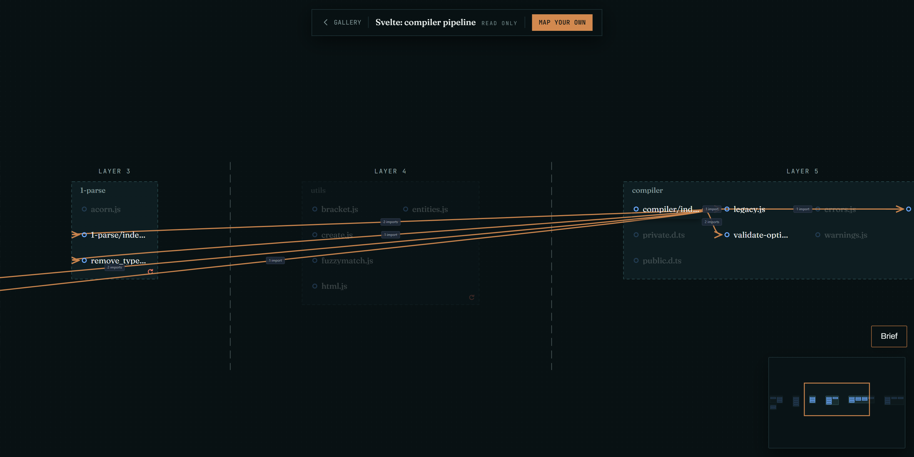

# NeedyNodes

**Your codebase, as a map you can read.**

Paste a public GitHub repo or drop a folder. NeedyNodes parses it in your browser and draws it as a map: folders are places, files sit in the direction their imports run, and the lines show up when you point at something.

**Try it now at [needynodes.com](https://needynodes.com).** Free, no sign-up.



## Why

Reading an unfamiliar codebase file by file is slow. NeedyNodes gives you the aerial view first: where the code starts, what everything rests on, where it is tangled, and what a change to one file can reach. Then you know where to start reading.

## What it does

- **A map, not a hairball.** Folders become regions, and files are laid out from where the code starts to what everything rests on. No lines at rest: point at a file to see what it uses and what uses it.
- **Zoom from folders to functions.** Far out you see folders, closer in the files, and up close each file's functions, classes and exports.
- **What a change can reach.** Double click a file to see every file a change to it could affect, and copy that list as a checklist.
- **The brief.** A few lines that read the map for you: where it starts, what everything rests on, where it is tangled, which file reaches furthest. Click a line and the map shows it.
- **What changed.** Drop a folder again, or update a map from GitHub, and the brief tells you what changed since your last map: files, imports, new cycles, and how far the changes reach.
- **New commits.** Open a map you made from GitHub and NeedyNodes tells you when the repo has moved on, with one click to update.
- **Findings.** Unresolved imports, dead ends, circular dependencies, unused files and oversized files, with a copy button for handing them to an AI.
- **100% in your browser.** Your code is never uploaded. There is no server that sees it.
- **Many languages.** Full parsing for JavaScript (including .mjs and .cjs), TypeScript, JSX/TSX, Vue, Svelte, Python, Go, Rust and PHP; compact cards for CSS/SCSS/Less, HTML, JSON and YAML/TOML. Up to 1000 files per map.
- **Save, share, come back.** Save a map to a file, share it as a link, or add a saved map to the one you have. Your last map is there when you return.
- **Maps already drawn.** The [gallery](https://needynodes.com/gallery) has 32 well-known open source projects mapped, from Flask and FastAPI to Gin, ripgrep and Zustand.

## Open any public repo

Put `needynodes.com/` in front of a GitHub address and the repo opens as a map:

```
https://needynodes.com/github.com/pallets/flask
```

To link your own repo's map from its README, add this badge (with your owner and repo):

```markdown
[](https://needynodes.com/github.com/OWNER/REPO)
```

## How it's built

React 19 · TypeScript · Vite · ReactFlow · Zustand · Tailwind CSS 4 · @babel/parser for JS/TS · custom parsers for Python, Go, Rust and PHP. Parsing runs in a Web Worker; no tree-sitter or WASM, which keeps the bundle small.

## About this repo

This repo is the public home of NeedyNodes: docs, roadmap discussion, bug reports and feature requests. The app itself is a hosted service at [needynodes.com](https://needynodes.com), and its source is not (yet) open.

## Feedback and issues

Found a bug or want a feature? [Open an issue](https://github.com/linkanjj/NeedyNodes/issues). Feedback is very welcome.
